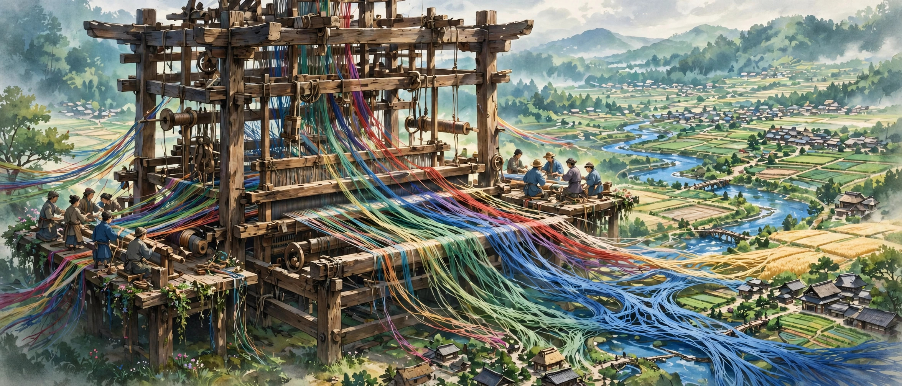
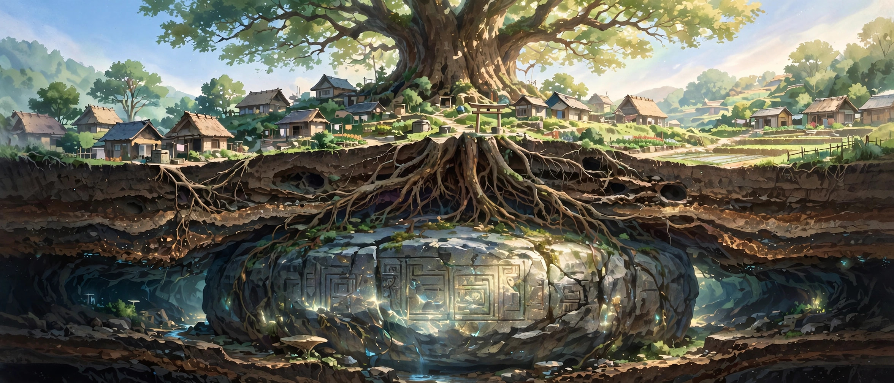

::: hero
# 言織世界

如果說凌極世界是「橋」，言織就是「彼岸的土壤」—— 一套以語言共識為基礎的協作制度：**言織協議 v4.0**。
:::

## 七自由

言織世界的基本權利。任何制度設計，都不能侵犯這七項自由：

::: cards
#### 創世
每個人都有創造新社群、新規則、新可能的權利。世界不是被發現的，是被創造的。

#### 退出
退出成本，是衡量制度正當性的唯一有效指標。任何不讓人好走的制度，都不值得留下。

#### 分支
不同意？分叉出去做自己的實驗。成功的分支會被抄走，失敗的分支安靜凋零 —— 演化需要分叉。

#### 攜帶
屬於你的資料、記憶、聲譽與關係，你有權一鍵打包帶走。離開的成本趨近於零，留下才都是真心的。

#### 歸屬
無論走多遠，總有一個地方亮著燈，留著你的位置。每個人都值得一個可以回去的地方。

#### 遺忘
每個人都有被遺忘的權利。過去不該是永恆的枷鎖，刪除不需要解釋。
:::

*（第七項自由，在舊站上以「等」字保留 —— 它屬於未來，屬於第一個為它命名的人。）*

## 三層架構

- **個人層**：你的自由、你的資料、你的選擇。任何上層決策不得侵犯個人層。
- **社群層**：自願組成的協作單元，各自實驗、各自演化。分支自由在這裡發生。
- **文明層**：跨社群的協作框架，應對沒有單一社群能獨自解決的挑戰。

## 制度設計

::: cards
#### MCI 貢獻體系
多維貢獻指數：每一次微小貢獻都被記錄、被承認。貢獻本身就是貨幣。

#### 交易可逆
任何新制度都有試用期。不好，就退回上一版。後悔有藥，是文明的基本配備。

#### 聲譽協議
聲譽跟著人走，不跟著平台走。攜帶自由的技術實現。

#### 制度演化
制度本身也要迭代。定期檢視、公開覆盤、允許分支 —— 沒有永恆正確的規則。
:::

## 創世憲法

整個言織世界，**唯一不可修改的，就是「創世憲法」**：每個人生而擁有七自由。其他一切，皆可討論、皆可演化。

## 未來城市的一日

想看看協議運作起來的日常？讀這篇敘事：

::: cta
[言織土壤上的一日](/plan/yanzhi-utopia/)
:::
